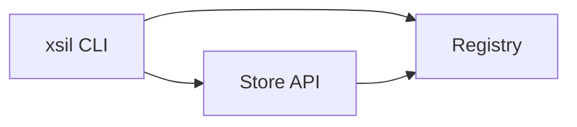

# ExtenSilica Architecture

**ExtenSilica** is a **standard and toolchain** for **reproducible RISC-V extensions** (see [spec/xsil.md](../spec/xsil.md), [pivot-v2.md](./pivot-v2.md)).

There is **no monetization layer**: no credits, license tokens, Stripe, USDC, or payment APIs.

## Components

| Piece | Role |
|-------|------|
| **`spec/xsil.md`** | Normative `.xsil` layout and manifest. |
| **CLI (`cli/`)** | `xsil` — install, run, test, validate; uses manifest-defined targets only. |
| **Registry** | Host `.xsil` blobs (e.g. Verdaccio). |
| **Store backend** | Optional HTTP API for metadata, search, auth for developers; **no** `/api/licenses` or `/api/payments`. |
| **Store frontend** | Optional UI to browse extensions and copy install commands. |

## Diagram (informal)

## Related

- [security-model.md](./security-model.md) — hashes and signatures (technical only).
- [README.md](../README.md) — repository overview.
